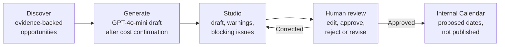
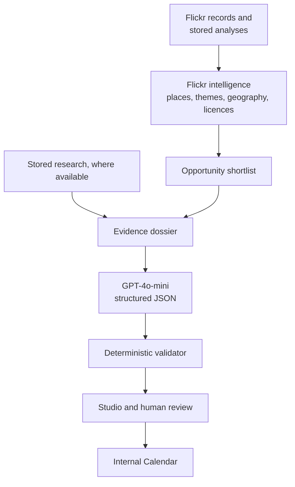

# ATIA — Autonomous Tourism Intelligence Agent

**ATIA turns photographs people already share of Saudi Arabia into evidence-backed campaign ideas, bilingual drafts and an internal launch plan, with a person approving every step that matters.**

As Saudi Arabia develops its tourism sector under Vision 2030, its appeal extends well beyond the best-known names: stone-tower villages in Asir, coral-stone houses on the Farasan Islands, date-palm country in Al Qassim, ancient rock art near Najran. ATIA helps a tourism marketing team find angles like these in public photography, see exactly what supports each one, and take an idea through to a reviewed campaign plan in one workflow.


<sub>"Rijal Alma village, Asir Region, Saudi Arabia (5)" by Richard Mortel, [CC BY 2.0](https://creativecommons.org/licenses/by/2.0/). One of the campaign images in the public demo. [All photo credits](demo/images/ATTRIBUTION.md).</sub>

**Try it with no API keys:** [Demo & Quick Start](#demo--quick-start)

## The Problem

People publish a steady stream of photographs of places they visit, tagged with locations and descriptions. For a marketing team, that material is hard to use:

- Promising angles can be missed because the records are scattered, bilingual and inconsistently labelled.
- A geotag shows where a camera was, not what a place offers.
- Generative AI can produce polished copy quickly, including confident claims nobody can support.

Teams need a way to work from real records without treating them as more than they are.

## The Solution

ATIA connects public evidence to a controlled marketing workflow:

1. **It organises the evidence.** It extracts named places, regional experiences and tourism themes from Flickr records, keeping each signal's source and strength visible.
2. **It drafts bilingual campaigns.** GPT-4o-mini writes an English and Arabic campaign using only the supplied evidence.
3. **It checks the draft.** Deterministic rules separate problems a reviewer can judge from claims that must be corrected first.
4. **It keeps people in charge.** Nothing reaches the Calendar without human approval, and nothing is ever published.

## How ATIA Works



- **Discover** shows each opportunity with its evidence class, photo and photographer counts, and any licensed images. Opportunities can be a named place or a broader regional experience, such as agricultural tourism in Al Qassim, which needs no single named site.
- **Generate** starts only after a person confirms the possible charge. It sends one request and never retries.
- **Studio** labels every pending draft **Ready for approval**, **Draft · N warnings** or **Needs correction**, and lists the findings. Each claim appears beside the records it cites, and all copy can be edited.
- **Human review** records the decision. Editing creates a new revision and the original AI draft is kept.
- **Calendar** turns an approved campaign and a chosen launch date into proposed internal dates. It has no connection to any social media platform.

### What the validator does

| Finding | Examples | Effect |
|---|---|---|
| **Blocking** | Uncited claims, evidence references that don't exist, invented figures, missing Arabic, schedule mismatches, "growing demand", implied tours or bookings, a claim that a place is "popular" with no record saying so, terms on a short unsafe-content list | The draft stays visible, but cannot be approved until corrected |
| **Warning** | Promotional wording such as "premier", "popular" in marketing copy, proposed KPI targets | Shown to the reviewer; a person may still approve |

Findings are recalculated for each revision, so correcting a draft clears its block. Output that is malformed or contains no campaign creates no draft; its text is kept in the run record and the reason is shown.

## AI & Technical Architecture



| Component | Role | When it runs |
|---|---|---|
| **GPT-4o-mini** (OpenAI Responses API) | Writes the structured bilingual campaign from the dossier. It receives records, not images, and never chooses images. | One request per confirmed generation. Needs a key. |
| **Flickr intelligence** | Deterministic extraction of places, themes, geography and licence status. No model involved. | Manual build; results are stored. |
| **Validator** | Rule-based checks described above. | On generation and on every read of a draft. |
| **OpenCLIP** ViT-B/32 | Tourism relevance screening and visual analysis of images. | Manual and optional, on a **limited subset** (see below). Not run by the demo or during generation. |
| **Bounded research agent** | Command-line investigation using stored evidence and optional Tavily search, with limits on requests, tool calls and cost. | Manual and optional. It can propose, but cannot approve. |
| **Image moderation** | Local NSFW screening plus visual inspection of collected photographs, so new images stay hidden until reviewed. | Manual and optional. |
| **XLM-RoBERTa** | Arabic and English sentiment for Flickr comments. | Manual and optional. |

**How far the AI analysis reached.** The research database holds 197 archive photographs and 86 collected ones. Stored OpenCLIP relevance results exist for 11 archive and 4 collected photographs, and just 1 of the demo's 25 evidence records carries one. ATIA's signals come mainly from metadata, not from AI analysis of every image.

**How far autonomy goes.** The optional agent can choose what to investigate within fixed limits. The campaign workflow is human-controlled: a person starts generation, reviews the output and approves it. The five demo opportunities are a hand-picked shortlist drawn from 89 signals that the intelligence build found (`config/mvp-opportunities.json`).

**Stack:** Python 3.10+, FastAPI, SQLite, React 19, TypeScript, Vite, Tailwind CSS, pytest and Vitest.

## Demo & Quick Start

The demo needs Python 3.10+ and Node.js, and no API keys.

```bash
git clone https://github.com/lameessa/ATIA.git
cd ATIA
python3 -m venv .venv && source .venv/bin/activate
python -m pip install -r requirements.txt -e .
atia demo init        # creates data/demo.sqlite3 with the saved campaigns and photos
atia demo validate    # runs the real validator on a saved draft; no model call
ATIA_DB_PATH=data/demo.sqlite3 uvicorn atia.api.main:app --host 127.0.0.1 --port 8000
```

In a second terminal, from the `ATIA` folder:

```bash
npm --prefix frontend ci
npm --prefix frontend run dev
```

Open **http://127.0.0.1:5173**.

### What to try

1. **Studio:** filter the five campaigns by status, then open **Valleys and Waterscapes in Riyadh** to see a blocked draft and its reasons.
2. **Review:** open **Farasan Islands**, read its warnings and the evidence behind its claims, then approve it with a launch date.
3. **Calendar:** see the proposed internal dates for Al Qassim, and for Farasan once approved.
4. **Discover:** browse the opportunities and their evidence classes.

To start over, stop the server, delete `data/demo.sqlite3` and run `atia demo init` again.

### What the demo does and doesn't do

| | Public demo, no keys | With your own OpenAI key |
|---|---|---|
| Browse evidence, Studio and Calendar | Yes | Yes |
| Edit, review and approve saved drafts | Yes | Yes |
| Validator | Real rules, run on saved model output | Real rules, run on new output |
| Generate a **new** campaign | No; ATIA says configuration is needed and sends nothing | Yes, after you confirm the possible charge |

All five demo campaigns are **saved GPT-4o-mini outputs**, so each opportunity shows **Open campaign**. Rejecting a draft brings back **Create Campaign**.

To generate live, run `cp .env.example .env`, add `OPENAI_API_KEY`, and restart the server. Each run has a local cost cap of $0.05, with $0.25 across all runs; these are local estimates, not your OpenAI balance. Flickr is never contacted at startup or just because a key exists: retrieval commands also need `ATIA_ENABLE_LIVE_FLICKR=1`. See the [technical documentation](docs/TECHNICAL_DOCUMENTATION.md).

## Results & Evaluation

### Five real campaigns from GPT-4o-mini

| Campaign | Evidence class | Photos / photographers | Status in the demo | Validator findings |
|---|---|---|---|---|
| Al Qassim Among the Palms | Moderate | 3 / 3 | Approved, on the Calendar | Clear after correction |
| Farasan Islands | Strong | 10 / 8 | Draft, 2 warnings | "premier"; proposed 5% target |
| Discover Rijal Almaa | Strong | 6 / 6 | Draft, 2 warnings | Proposed 5% target; duplicate post ID renumbered |
| Discover the Ancient Rock Art of Najran | Exploratory | 1 / 1 | Draft, 1 warning | Proposed 30% target |
| Valleys and Waterscapes in Riyadh | Strong | 5 / 5 | **Needs correction** | Blocked: claims "popular among families" without a supporting record, and links engagement to interest. Also a warning on a proposed target of 500 |

**What this shows:**

- **The model tends to over-claim, and the checks catch it.** Every saved draft started with at least one finding, even though the prompt forbids much of what was found.
- **The checks work on real output.** The original Al Qassim draft claimed "growing interest", which the Flickr records can't show; `atia demo validate` reproduces that rejection. A later revision fixed it, with the edit recorded as an AI-assisted editorial correction, and a person then approved it.
- **Six model requests produced these results,** at an estimated $0.0061 in total from token usage. One earlier Al Qassim attempt was rejected for missing required content. An earlier, stricter validator refused the other four drafts outright; the current version keeps them for review, and Riyadh remains blocked.

### Testing

Verified on a clean clone of this repository, with no API keys and only `requirements.txt` installed:

- **Backend:** 376 tests passed, 3 skipped because they need optional modules.
- **Frontend:** 27 tests passed, and the production build succeeds.

Tests use temporary databases and mocked AI responses, so they verify ATIA's logic, not the quality of live model output. Sample size matters too: five campaigns demonstrate the workflow, but are not a statistical evaluation of the model or of marketing outcomes.

## Limitations & Responsible AI

- **Engagement is not demand.** Views, favourites and comments describe individual photographs. ATIA does not measure tourism demand or visitor behaviour, and has not proven demand for any destination.
- **ATIA suggests; it doesn't rank what is underpromoted.** It offers evidence-backed marketing hypotheses. It does not objectively identify destinations as overlooked or underpromoted.
- **Evidence strength is limited.** Evidence classes reflect how many photographers and records support a signal, on a small sample. Geotags and user descriptions can be wrong, and exact place identities are often unverified.
- **The validator is rule-based.** It catches known patterns, not every misleading statement, and its unsafe-content check is a short word list, not full moderation. A person remains responsible for what is approved.
- **Images need rights and review.** Evidence and display are separate permissions: All Rights Reserved photographs can count as evidence but are never shown. A photograph displays only if Flickr reports it safe and reusable and its exact bytes have a recorded review. The 15 demo photographs were visually checked by AI assistants, not people, and are labelled that way in the app. New photographs stay hidden until a person approves them. A licence check is not legal clearance and doesn't cover people or property rights.
- **Humans stay in control.** Nothing reaches the Calendar without human approval, and ATIA has no automatic publishing. The Calendar is an internal plan, and it doesn't post to any platform.
- **Arabic needs review.** The AI-written Arabic hasn't been reviewed by a native-speaking marketing professional.
- **This is an MVP.** It runs locally, with no user authentication, and needs both before any hosted use.

## Technical Documentation

- [Technical documentation](docs/TECHNICAL_DOCUMENTATION.md): setup, CLI commands, data model, research methodology and development phases
- [Phase reports](docs/reports/README.md): validation reports and audits from each stage
- [Frontend guide](frontend/README.md): the Studio, Discover and Calendar interface
- [Photo credits](demo/images/ATTRIBUTION.md): photographers and licences for the demo images

## License & Attribution

**Code:** no license has been granted for this code, so all rights are reserved.

**Photographs:** the 15 images in `demo/images` belong to their photographers and are redistributed unmodified under their own licences (12 CC BY 2.0, 1 CC BY-SA 2.0, 2 CC BY 4.0). See [`ATTRIBUTION.md`](demo/images/ATTRIBUTION.md). Evidence citations in the demo data refer to public Flickr records, and those photographs and records remain their owners' property.
